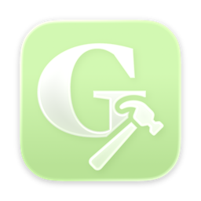
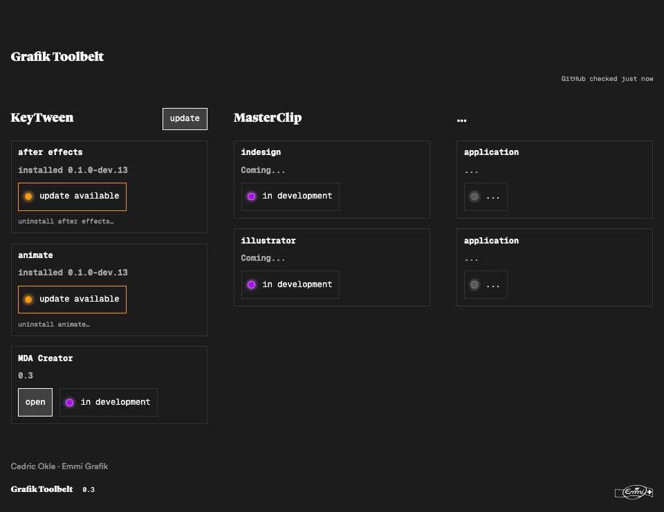

<h1 align="center">Grafik Toolbelt</h1>

Deine kreativen Apps und Adobe-Plugins an einem Ort.

<a href="https://github.com/oklepunkt/Grafik-Toolbelt-Releases/releases/latest"><strong>Neueste Version für macOS herunterladen</strong></a>

Disclaimer: Dieses Tool ist mit Codex entwickelt worden.
Es ist für interne Zwecke gedacht und nicht für die Öffentlichkeit bestimmt.

Grafik Toolbelt installiert und aktualisiert unsere eigenen kreativen Tools. Plugins verwaltest du im kompakten Hauptfenster. Eigenständige Apps wie **MDA Creator** öffnen sich in einem eigenen Fenster.

### Installation

Hey Teammitglieder, hier auf dem GitHub findet ihr die neuste Version vom "Grafik Toolbelt" dass ist der installer und über den ihr alles installiert das ich erstelle.

1. Gehe zu Releases (in der Sidebar) und lade dir von der neusten Version das "Grafik-Toolbelt-XX-macOS-universal.dmg" herunter. 

2. öffne sie im Downloads Ordner und ziehe Grafik Toolbelt in den Ordner Programme (Applications). Nun öffne die App, falls du sie zum ersten mal herrunterlädst wird sie von macOS abgelehnt (da ich kein Apple Developer Account habe und es nicht signiren kann). Gehe unter Systemeinstellungen -> Datenschutz & Sicherheit und scrolle runter bis "Sicherheit" dort findest du die Option die App trotzdem zu öffnen, nun müsst ihr es noch mit dem Passwort bestätigen. Danach könnt ihr erneut die App aufmachen.

3. Nun könnt ihr im Grafik Toolbelt die Keytween Plugins automatisch installieren lassen, dabei sollten beide Programme geschlossen sein. Nun findet ihr unter Fenster  -> Erweiterungen das Keytween Panel in beiden Programmen.

### Nutzen

Wenn ihr nun eure Composition fertig habt und es ins Animate ziehen möchtet geht das über die Buttons die oben vom Keytween Fenster leben.

Push Selection: Die Angewählten Layer werden in Animate importiert.

Push Composition: Die Auswählte Composition wird in Animate importiert, achtet darauf das ihr keine precomps ausgewählt habt. 

Wenn ihr nun mehrere Animate Dateien erstellt müsst ihr in Animate nur einen neuen HTML5 Canvas erstellen, die Grösse wird automatisch angepasst.

### Preview-Status

Die aktuelle Version ist ein **Preview-Build ohne Apple-Notarisierung**. MDA Creator und MasterClip enthalten Funktionen in Entwicklung. Die neuesten Änderungen benötigen weiterhin Tests in der nativen App und den Adobe-Programmen.

Dieses öffentliche Repository enthält Downloads, Release Notes und Dokumentation. Für den Download ist kein GitHub-Konto nötig. Die Entwicklung liegt in einem separaten privaten Repository. Toolbelt-Releases enthalten die DMG, separate Plugin-Releases das Plugin-ZIP. GitHub ergänzt Quellcodearchive dieses Dokumentations-Repositorys.

— Cedric Okle · Emmi Grafik
